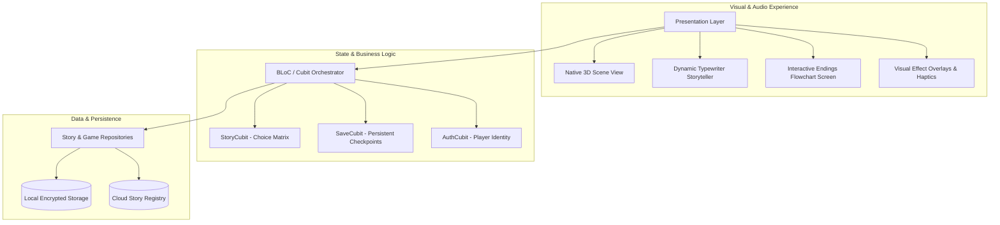

# 🎮 Nexus 3D — Interactive Branching Storyscapes & Narrative Engine

[](https://flutter.dev)
[](https://dart.dev)
[](#)
[](#)

> **Next-Generation Interactive Fiction Platform**: Real-time branching narrative trees, 3D ambient game scenes, multi-ending discovery visualizers, glassmorphism UI, and gamified player progression.

---

## 🏛️ System Architecture



---

## 🌟 Key Features

1. **Dynamic Narrative Branching Matrix**:
   - Complex decision trees where every player choice alters narrative vectors, unlocking hidden paths and divergent outcomes.
   - Real-time flowchart visualizer (`EndingsFlowchartScreen`) displaying completed and locked story endings.

2. **Native 3D Scene Integration (`Native3DSceneWidget`)**:
   - Embedded 3D viewport delivering environmental immersion and interactive spatial props.

3. **Modern Visual Aesthetics**:
   - Custom Glassmorphism design system (`GlassContainer`) with fluid ambient particle animations.
   - Paced typewriter dialog rendering (`TypewriterText`) with auditory punctuation cues.

4. **Robust Clean Architecture**:
   - Clear separation of concerns: Presentation (Cubits/Screens), Domain (Entities/Contracts), and Data (Local/Remote datasources).
   - Instant checkpoint recovery (`SaveService`) preserving player inventory, karma score, and unlocked paths.

---

## 🛠️ Build & Run

### 1. Prerequisites
- Flutter SDK 3.16+
- Android Studio / VS Code

### 2. Setup
```bash
flutter pub get
flutter run
```
